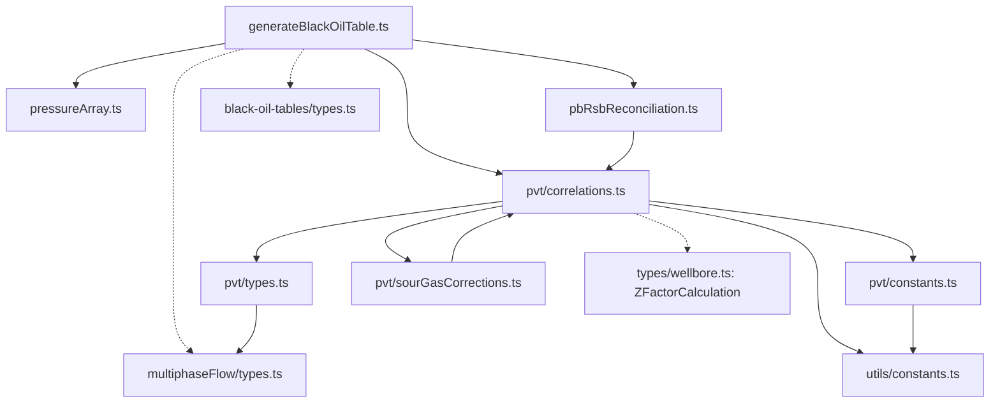

# Nexus dependency map for Analytics extraction

**Recorded:** October 9, 2026. **Method:** manual source inspection by GPT-6 Luna, with targeted import checks by main. **Graphify status:** unavailable in this session; this is not a Graphify-generated graph.

**Connection follow-up:** Graphify tools became available in the subsequent turn. Workspace/repository discovery failed with HTTP 403, `No workspace is selected for this agent.` The [setup guide](../2026-10-09-repository-setup.md) records the hosted connection steps. This map remains manual; no indexed graph query has succeeded.

**Local follow-up:** the owner then selected the open-source repository. A separate [local Graphify run](../2026-10-09-local-graphify.md) now covers 24 selected source files and has passed Luna's query checks. This document retains the earlier manual findings; generated graph omissions are recorded in the local setup report.

This bounded map supports A-01 in [the repository setup guide](../2026-10-09-repository-setup.md). It covers the selected PVT/black-oil slice and its immediate adapter boundaries. It does not cover the entire Nexus calculator, forecasting tools or the future Explorer source tree. Application implementation remains in the two owning repositories.

**Source checkout:** `C:/Users/thai.phi/Downloads/python/mclaren/esp-nexus-wellbore-pr`. Reported HEAD: `c418bd93bfb8d758df35cc174c4b66c2ab62e5f9`. Locations below refer to inspected local files; checkout cleanliness was not established. Record copied-file hashes/revisions during extraction and refresh this map when imports or interfaces change.

## Engineering dependency slice

Arrows mean that the originating module imports the target. Dotted arrows are type-only imports. This diagram omits UI and export adapters, listed separately below.

| Import/call evidence in Nexus | Extraction implication |
|---|---|
| `src/components/black-oil-tables/engine/generateBlackOilTable.ts:8`, `:9`, `:10`, `:16`, `:17`; function `:62`, PVT call `:94` | Carry pressure-array/reconciliation helpers, table types and `PVTConfig` with the selected engine. Preserve the engine's local density/conversion constants at `:20` onward. |
| `src/components/black-oil-tables/engine/pressureArray.ts:21`; `engine/pbRsbReconciliation.ts:9`, `:49` | Pressure construction and Pb/Rsb reconciliation are separate engine primitives; reconciliation calls the shared correlation module. |
| `src/utils/pvt/correlations.ts:23`, `:36`, `:37`, `:38` | Correlations depend on PVT declarations/warning thresholds, PVT constants, shared constants and sour-gas helpers. |
| `src/utils/pvt/types.ts:8`; `src/utils/pvt/constants.ts:9` | Their re-exports reach `src/utils/multiphaseFlow/types.ts` and `src/utils/constants.ts`; copying only the PVT directory misses those dependencies. |
| `src/utils/pvt/correlations.ts:38`, `:1232`; `src/utils/pvt/sourGasCorrections.ts:13`, `:37`, `:49` | Sour-gas corrections import Sutton functions back from correlations. Preserve or deliberately resolve this reciprocal dependency when extracting; copying only one side is incomplete. |
| `src/utils/pvt/correlations.ts:1056`, `:1222`; `src/types/wellbore.ts:178` | `ZFactorCalculation` is type-only and contains numeric fields. Its definition can be separated without carrying unrelated wellbore UI/types. |
| `src/utils/pvt/correlations.ts:947`, `:977`, `:995`, `:1016`, `:1375` | Selected water/PVT functions and table-property calculation are reuse candidates. Pressure conventions differ across functions; this structural map does not establish correct SWD inputs. |

The PVT barrel (`src/utils/pvt/index.ts:7`) and engine barrel (`src/components/black-oil-tables/engine/index.ts:7`) expose entry points. The table engine imports correlations directly, while the input hook imports the engine barrel. Preserve an intentional receiving-app API rather than copying aliases without checking their targets.

## UI and export boundaries

| Source boundary | Immediate dependencies and evidence | Receiving-app action |
|---|---|---|
| `src/components/black-oil-tables/hooks/useBlackOilTableInputs.ts` | React hooks `:8`; table types `:9`; shared `PVTConfig` `:15`; validation `:16`; `MethodSettingsAccordion` defaults/types `:17`; engine `:21`, generation `:195` | Separate app settings/state from calculation inputs. Inspect selected defaults before reuse; do not bring the entire settings UI into the engine. |
| `src/components/black-oil-tables/validation.ts` | Table types and shared `PVTConfig` at `:8`–`:9` | Carry relevant input validation with its types; add SWD scenario constraints in the receiving app. |
| `src/components/black-oil-tables/components/BlackOilCharts.tsx`; `components/PVTPropertyChart.tsx` | Tabs/chart/table types at BlackOilCharts `:8`–`:10`; React, `react-plotly.js`, Plotly types, `ChartErrorBoundary` and table rows at PVTPropertyChart `:8`–`:12` | Adapt charts to Analytics layout and chosen packages. These are UI adapters, not calculation dependencies. |
| `src/components/black-oil-tables/export/excelExport.ts` | Table/shared types and `excelAdapter` at `:9`–`:12`; browser download `:20`; `generateBlackOilExcel` `:138`; `writeWorkbook` call `:155` | Preserve calculated rows, metadata and units in technical exports. XLSX reuse requires a receiving-app export adapter and browser behavior. |
| `src/services/excel/excelAdapter.ts` | ExcelJS `:1`, XLS detector `:2`, bundler worker import `:3` | Inspect the write path before copying this adapter. Its read/worker dependencies are outside this map's completed audit. |

## Reference-test boundaries and next use

Existing source tests identified for extraction review:

- `src/components/black-oil-tables/engine/generateBlackOilTable.test.ts:8`, `pressureArray.test.ts:8`, `pbRsbReconciliation.test.ts:8`: engine inputs/types and expected behavior.
- `src/components/black-oil-tables/engine/__tests__/pyrtValidation.test.ts:27`: recorded pyResToolbox reference comparison for the table engine.
- `src/utils/pvt/__tests__/correlations.test.ts:11`: PVT test entry point and correlation imports.

Read and select applicable fixtures before porting; preserve their recorded oracle versions. Run them in Analytics and add the unit, pressure-datum, injection-direction and capacity cases required by [the reuse record](2026-10-09-nexus-engineering-reuse.md). No numerical tests were run for this mapping task.

Use this map to check A-01's import closure, then map callers in the receiving Analytics app after extraction. Map Explorer acquisition/linkage/export modules when they exist. Once the workspace is selected and the relevant repositories are indexed in Graphify Cloud, main verifies the indexed revision and Luna queries those bounded slices; compare its structural findings with the source evidence and record the actual tool run and freshness. The hosted plugin does not build or update a graph from this local checkout.

**Coverage limits:** downstream callers across Nexus, full UI/settings and Excel-worker closure, all PVT test cases, the nodal/forecasting dependency slice and runtime/numerical behavior were not audited. Successful source reads are not implementation or test results. Targeted import searches and line-numbered reads passed; this record makes no application gate claim.
